<p align="center">
  
</p>

<h1 align="center">Pure SEO</h1>

<p align="center">
  An on-page SEO inspector for Chrome. Open it on any page to see what search engines see:<br>
  meta tags, headings, indexability, raw vs rendered HTML, HTTP headers, structured data, links and images.
</p>

<p align="center">
  
  
  
</p>

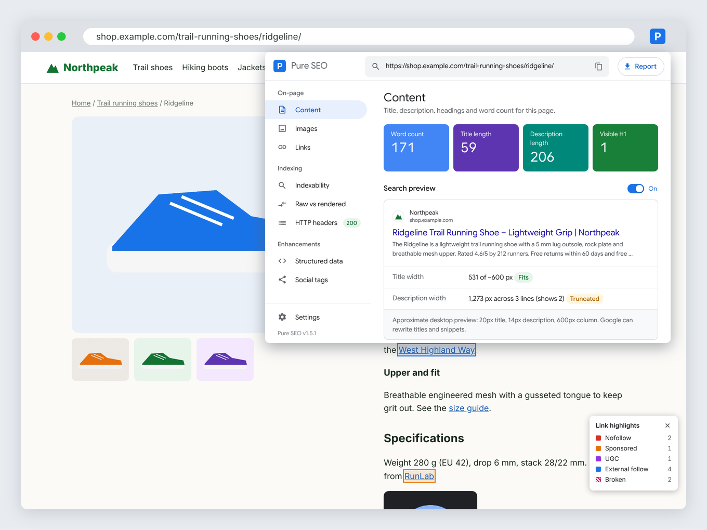

Pure SEO runs entirely in your browser. There is no account, no API key and no tracking. It reads the page you are on, asks that site for a few extra things (robots.txt, the raw HTML, link and image status), and shows the results in a Search Console-style panel. When you need to share findings, it exports a readable HTML report with prioritised issues and fixes, or an Excel workbook.

## Contents

- [What it checks](#what-it-checks)
- [Install](#install)
- [How to use it](#how-to-use-it)
- [Reports and exports](#reports-and-exports)
- [How the checks work](#how-the-checks-work)
- [Permissions](#permissions)
- [Privacy](#privacy)
- [Limitations](#limitations)
- [Project structure](#project-structure)
- [Development](#development)
- [Contributing](#contributing)
- [License](#license)

## What it checks

The popup has nine sections, grouped the way you would work through a page: on-page content first, then indexing, then enhancements.

### Content

Word count, title and description length, and the number of visible H1s, shown as tiles at the top.

The **search preview** draws the result at Google's desktop column width and measures the title and description in pixels, not characters. You can see whether the title fits in about 600 px and how many lines the description takes before Google cuts it off. The preview is off by default and remembers your choice.

Below that you get the language attribute, title, description (each with a copy button) and the published and modified dates. Dates are read from meta tags or JSON-LD.

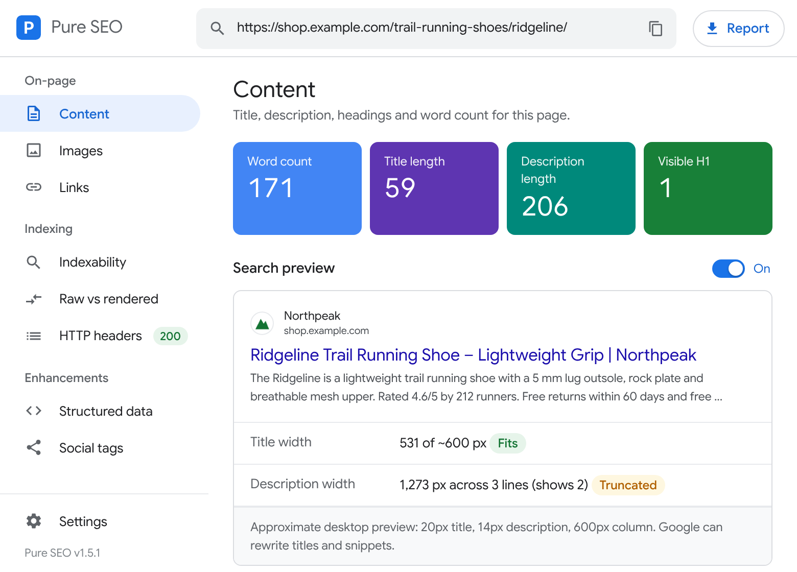

The **headings** table lists every H1–H6 in page order, indented by level, with a filter per level and a "Copy headings" button. Headings that visitors can't see are labelled. That covers headings hidden with CSS, headings clipped to screen-reader size, and headings moved off the page. Pure SEO only counts visible H1s as the page's H1.

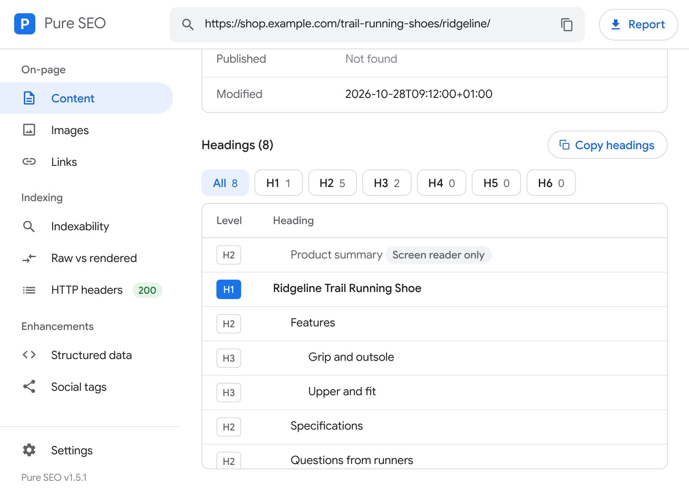

### Images

Each image shows:
- file name, format, file size, intrinsic size and on-screen size
- alt text and title
- HTTP status, once you run **Check status & size**

The tiles count missing alt text, missing width/height and images over 200 KB. The quick filters jump straight to these problem groups:

| Flag | Meaning |
| --- | --- |
| Missing alt | No `alt` attribute at all. An empty `alt=""` is shown separately as "Empty", which is correct for decorative images. |
| No width/height | No `width` and `height` attributes and no CSS `aspect-ratio`, so the layout can shift while the image loads. |
| Heavy | Over 200 KB. |
| Oversized | Intrinsic width is more than 1.5× what the screen needs (display width × device pixel ratio). |
| Not WebP/AVIF | JPEG, PNG, GIF, BMP or TIFF. |

You can search by URL, alt text or title, switch between file names and full URLs, and export the filtered list to Excel.

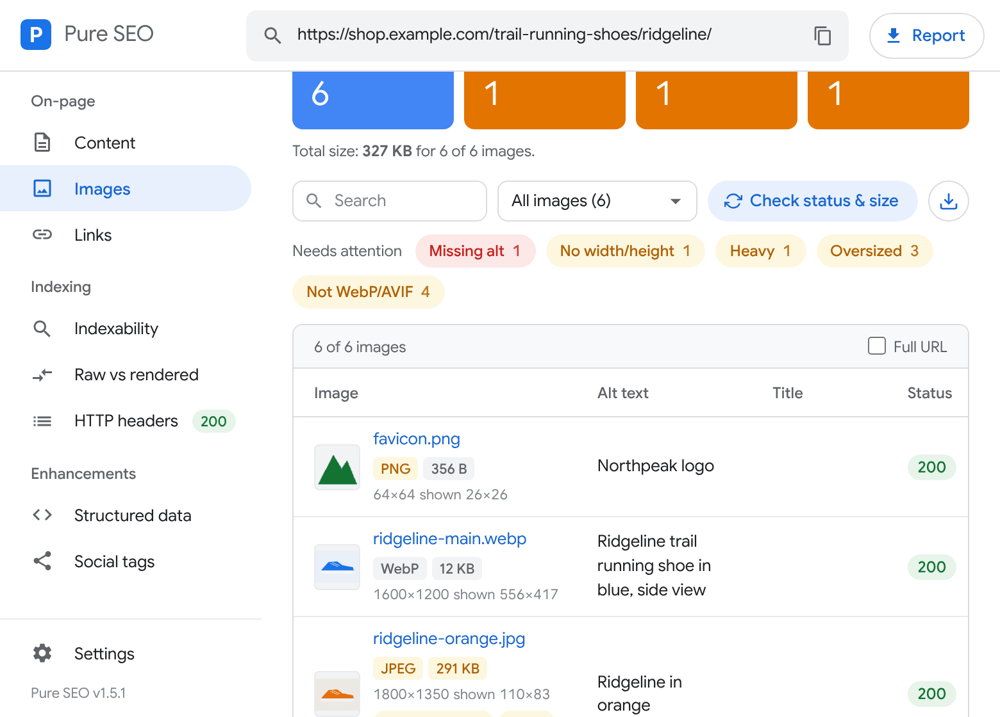

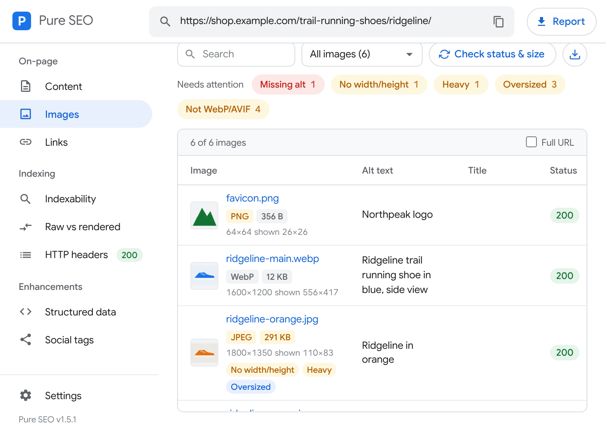

### Links

Every link on the page with its anchor text, its `rel` value (follow, nofollow, UGC, sponsored) and whether it is internal or external. **Check status** requests each unique URL once and fills in the status: 200, Redirect, 404, Failed, and so on. Failed links show the reason, such as "domain not found" or "blocked by another extension".

`mailto:`, `tel:` and other non-web links are labelled ("Email", "Phone") and never requested.

You can filter by rel, by internal/external and by status, search, and export to Excel.

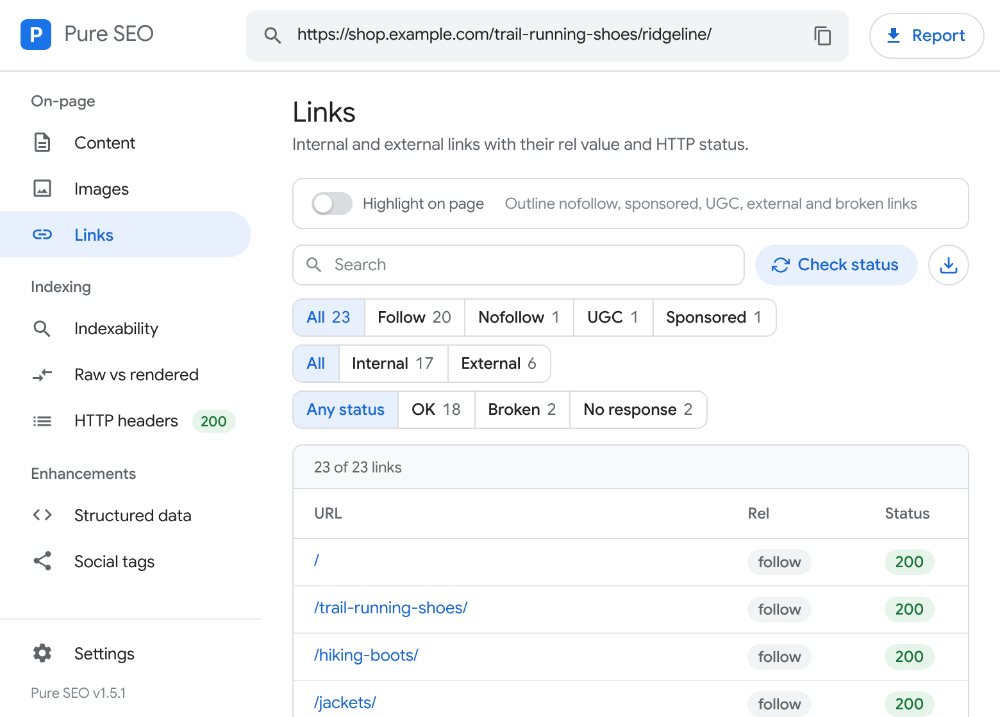

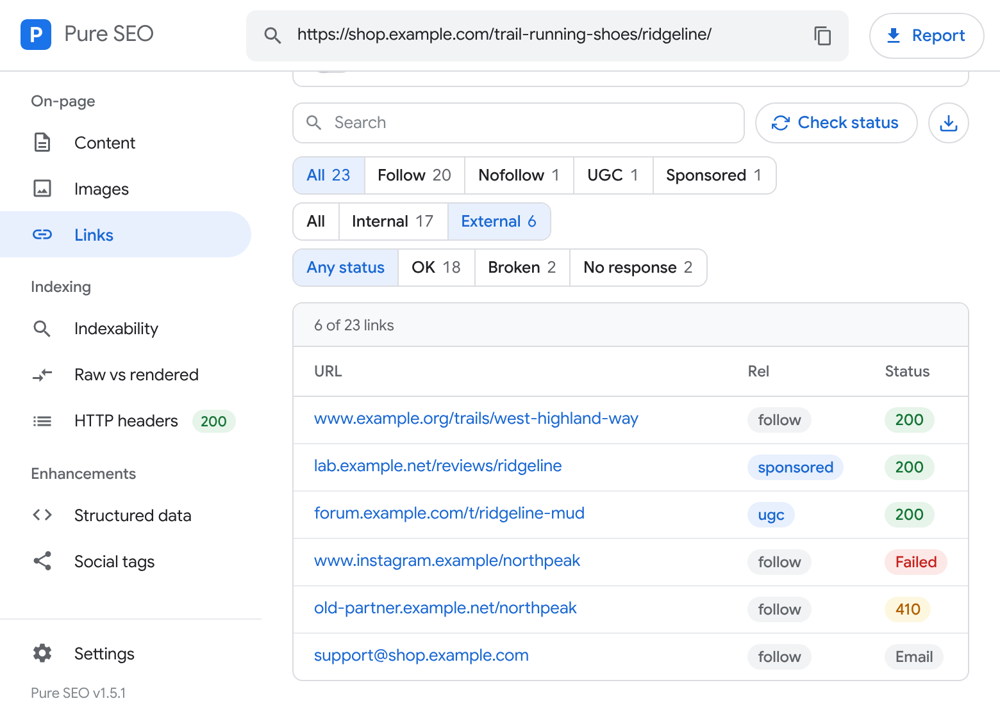

**Highlight on page** outlines links directly on the website: nofollow, sponsored, UGC, external follow and broken links each get their own colour. A small legend in the corner shows the count for each type. A broken link that is also nofollow keeps its nofollow colour and gets a dashed outline and strike-through on top, so you can see both facts at once. You can turn individual types on or off, and close the legend on the page to remove every highlight.

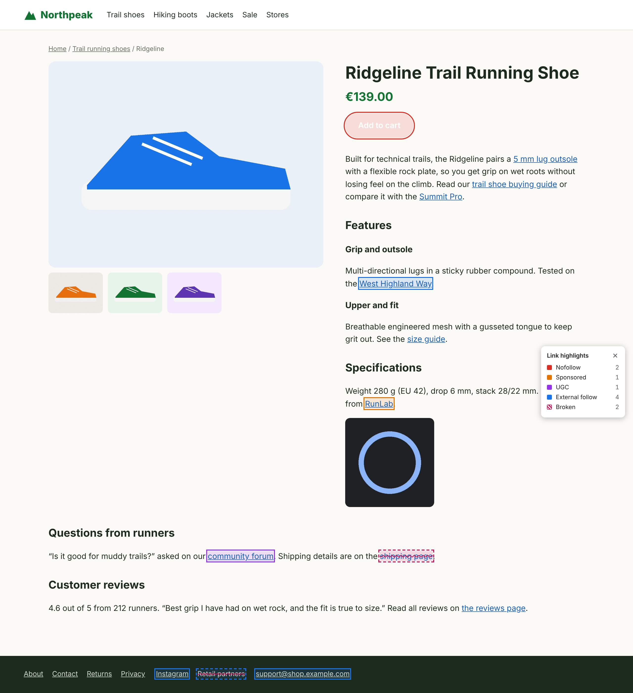

### Indexability

Everything that decides whether the URL can be crawled and indexed, in one place.

- **Canonical URL.** You get the canonical from the rendered page and from the raw HTML the server sent, plus the HTTP status of the canonical target. A canonical that redirects or returns an error is called out.
- **Robots directives.** This covers meta robots, meta googlebot and every `X-Robots-Tag` header. Header values scoped to another crawler (for example `bingbot: noindex`) are kept apart from Googlebot's.
- **robots.txt.** You see the file's status and whether Googlebot may crawl this URL, with the exact rule and line number that decided it. If the page has a Googlebot group and the `*` group would decide differently, that is noted too.
- **HTML size.** Uncompressed HTML size is compared against Googlebot's 2 MB fetch limit, with a warning when the page is close to or over it.
- **Sitemaps.** These are read from robots.txt, or `/sitemap.xml` is tried if robots.txt lists none, and each one is checked for reachability.
- **Hreflang.** Every alternate is listed with its language code.

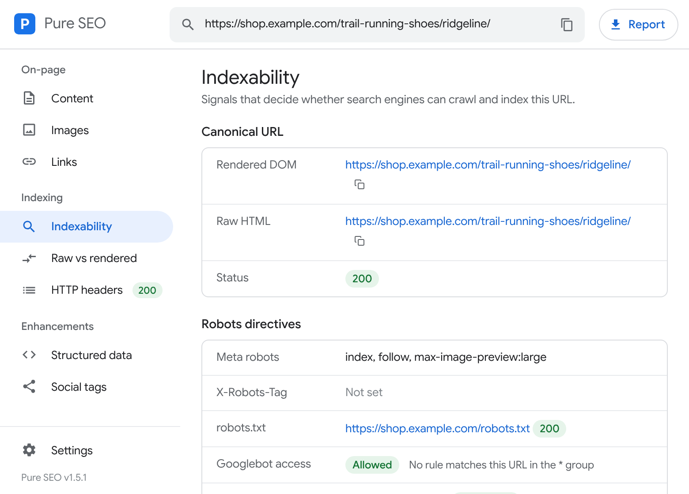

### Raw vs rendered

This compares the HTML the server sends with the live page after JavaScript has run. It checks the title, meta description, canonical, meta robots, meta googlebot, HTML lang, headings, links, hreflang, structured data, Open Graph tags, images and word count.

Each signal is marked Same, Changed by JavaScript, Added by JavaScript or Removed by JavaScript. Changes to the canonical, meta robots or meta googlebot count as critical, because Google may act on the raw value before rendering. Links that only exist after JavaScript runs are listed separately.

Use **Only differences** to hide matching rows and **Fetch again** to re-request the raw HTML.

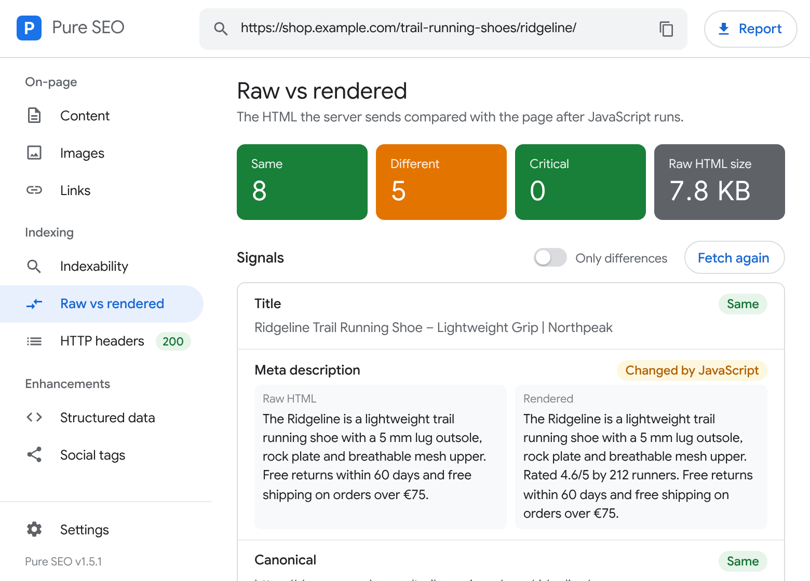

### HTTP headers

This shows the status code, the full redirect chain with each hop's status, the number of response headers, and the HTML size. All response headers are listed with copy buttons.

Headers are captured when the page loads, so on single-page apps they can belong to an earlier URL. For example, Next.js or PWA Studio change the address without a new request. Pure SEO detects this, explains why it happened (single-page navigation, Chrome preloading, back/forward cache, a service worker) and re-checks the current URL automatically with a fresh request. A **Re-check again** button is there if you want to repeat it.

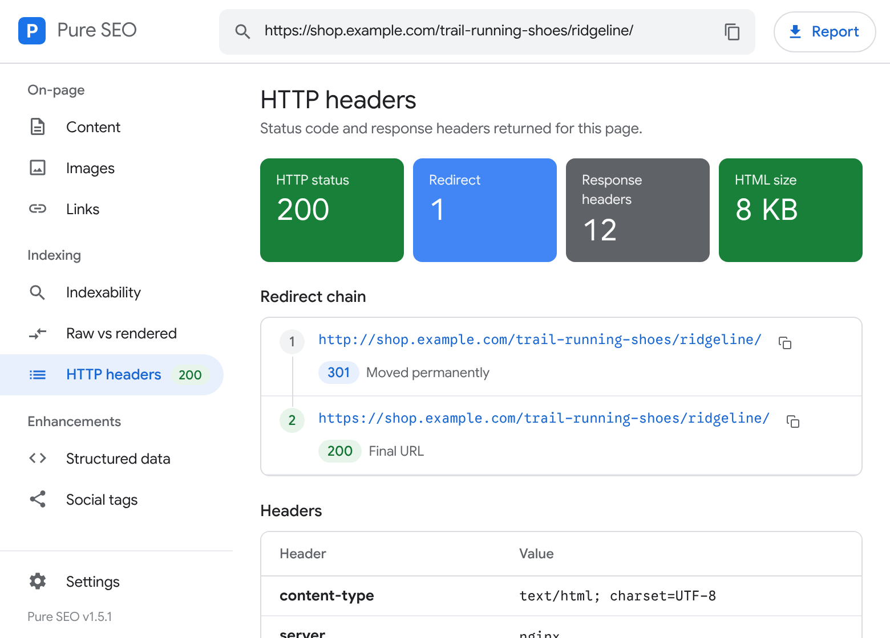

### Structured data

This finds JSON-LD, Microdata and RDFa, with two views:

- **Code:** a collapsible tree of the raw data.
- **Graph:** each entity as a card, colour-coded by kind (organization, navigation, product and offer, rating and review). References between entities are linked by `@id`. Breadcrumbs, prices, ratings and images are shown the way a person would read them.

One-click links open the page in Google's Rich Results Test and the Schema.org validator.

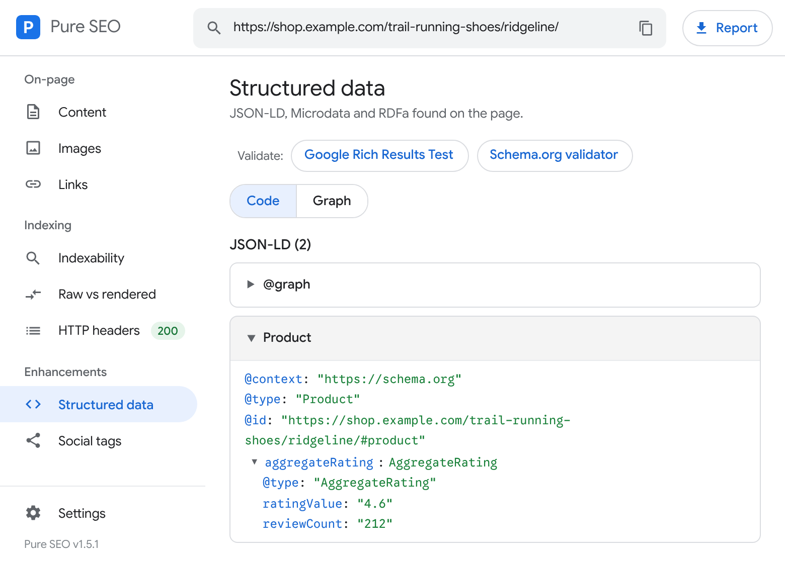

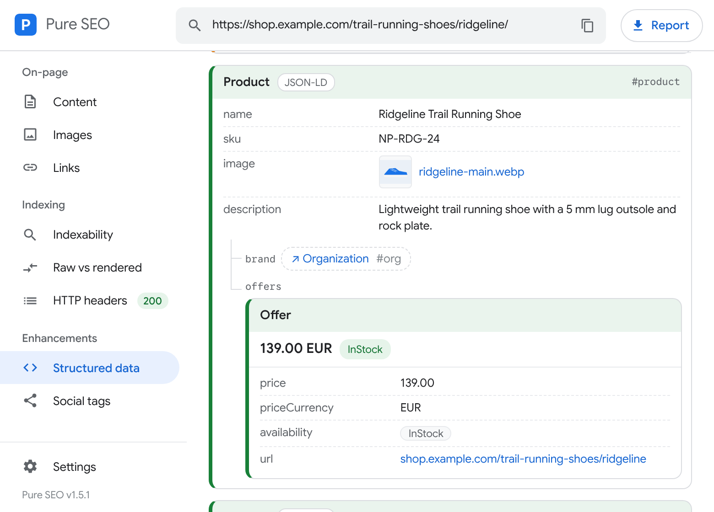

### Social tags

Open Graph and Twitter Card tags, with the common ones always listed. Missing tags show as "Missing", so the gaps are obvious. Image and URL values are clickable and resolved against the page URL.

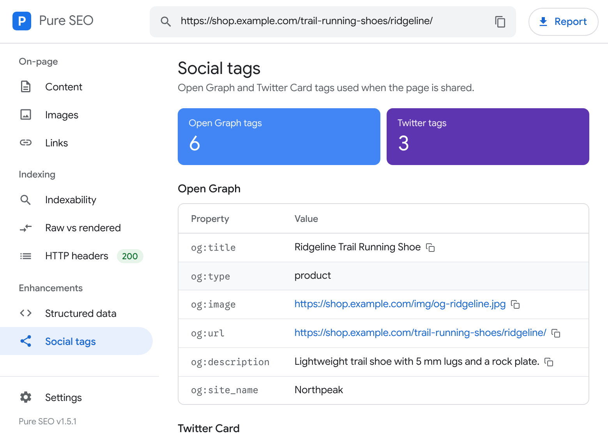

### Settings and dark mode

You can choose the theme (follow the system, dark or light) and which section the popup opens on: the last one you used, or a fixed section. A shortcut takes you to `chrome://extensions/shortcuts` to set a keyboard shortcut.

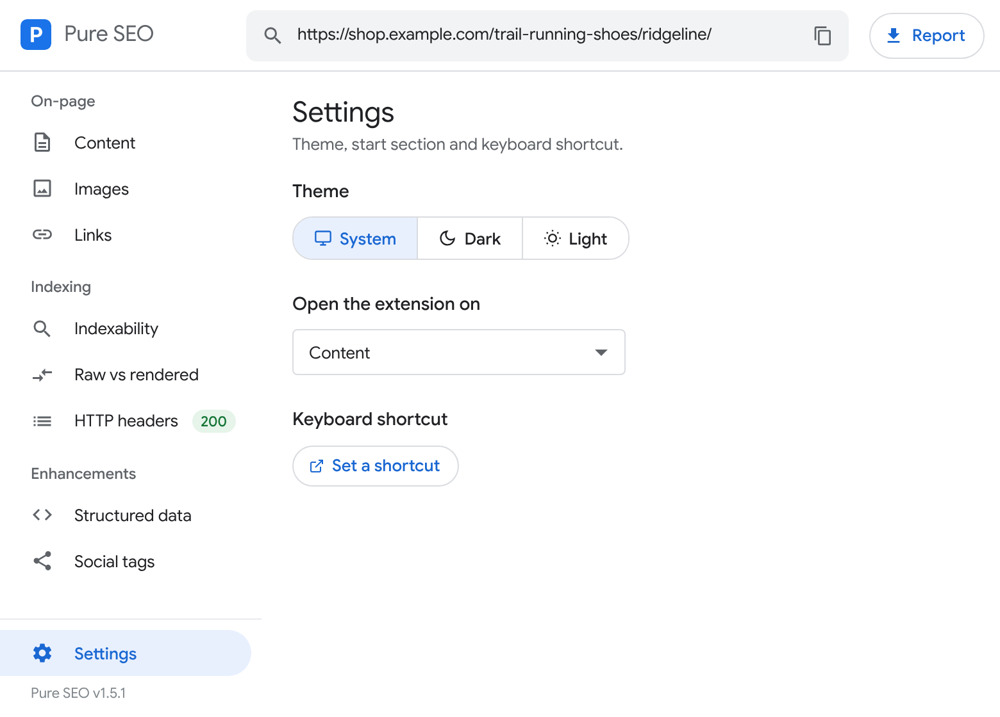

| Dark mode | |
| --- | --- |
| 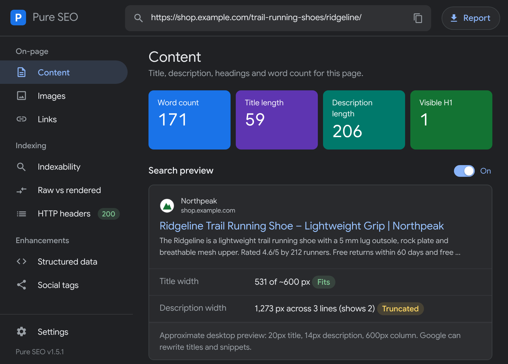 | 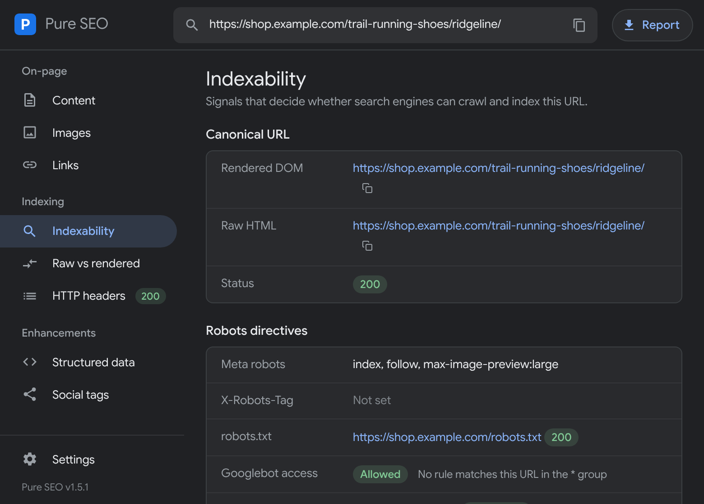 |

## Install

Pure SEO is not on the Chrome Web Store yet. Install it manually in under a minute. There is no build step.

### Option 1: Download the release (recommended)

1. Download [**`chrome-seo-extension.zip`**]([url](https://github.com/makashibk/chrome-seo-extension/releases/download/v1.5.1/chrome-seo-extension.zip)).
2. Unzip it into a folder you'll keep, such as `pure-seo`. Chrome loads the extension from this folder, so don't delete it afterwards.
3. Open `chrome://extensions` in Chrome.
4. Turn on **Developer mode** (top right).
5. Click **Load unpacked** and select the unzipped folder (the one that contains `manifest.json`).
6. Pin Pure SEO from the puzzle-piece menu so the icon stays in your toolbar.

### Option 2: Install from source

1. Clone the repository, or use **Code → Download ZIP** and unzip it:
   ```bash
   git clone https://github.com/makashibk/chrome-seo-extension.git
   ```
2. Open `chrome://extensions` and turn on **Developer mode**.
3. Click **Load unpacked** and select the `extension` folder inside the repository. Select that folder, not the repository root.
4. Pin Pure SEO from the puzzle-piece menu.

### Updating

- **From a release:** download the new zip from [Releases](https://github.com/makashibk/chrome-seo-extension/releases), replace the contents of your folder with the new files, then click the reload icon on the Pure SEO card in `chrome://extensions`.
- **From source:** run `git pull`, then click the reload icon on the Pure SEO card.

The extension is plain Manifest V3, so it should also load in other Chromium-based browsers that support MV3 extensions (Edge, Brave and others) through their own extensions page.

## How to use it

1. Open the page you want to check and click the Pure SEO icon.
2. The Content section, or whichever section you set, opens with data from the live page.
3. Move through the sections in the sidebar. Checks that send requests to the site only start when you open that section or export a report. These are robots.txt, raw HTML, canonical status and sitemaps.
4. In Links and Images, click **Check status** or **Check status & size** to request each URL.
5. Click **Report** in the top bar to export everything.

For the most accurate HTTP headers, have Pure SEO installed before the page loads, or reload the page once after installing. If the headers are missing or belong to another URL, the extension re-requests the current URL by itself.

## Reports and exports

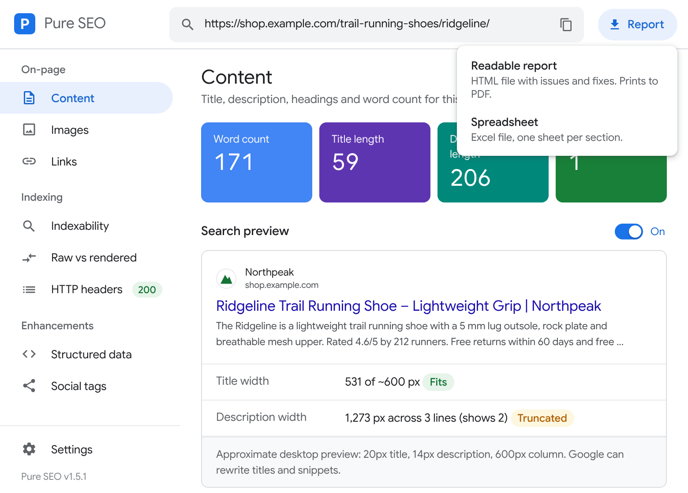

**Readable report (HTML).** This is a single self-contained file. The font and the site's favicon are embedded, so it looks the same offline and on any computer. It opens with a search preview, a summary of key signals and a priority bar. It then lists issues to fix sorted by priority (High, Medium, Low), each with the details found on the page and a concrete fix. It covers 37 checks across status, security, content, indexability, international, JavaScript rendering, images, links, social tags and structured data. Full detail sections follow, and the report has its own Auto/Light/Dark switch. Use the browser's print dialog to save it as PDF.

Before building the report, Pure SEO runs the link and image status checks, the raw HTML comparison and the indexability checks, so nothing is left blank. The Report button shows progress while this runs ("Checking 12 of 29").

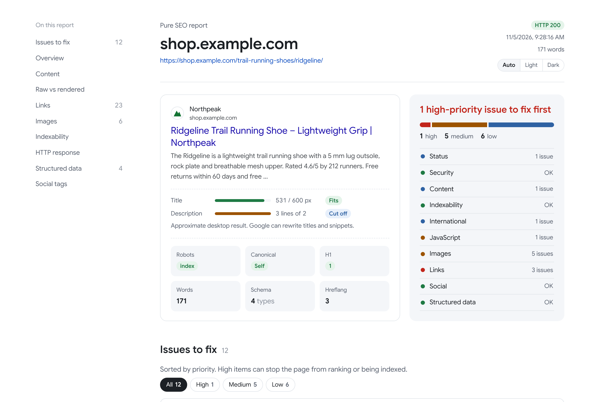

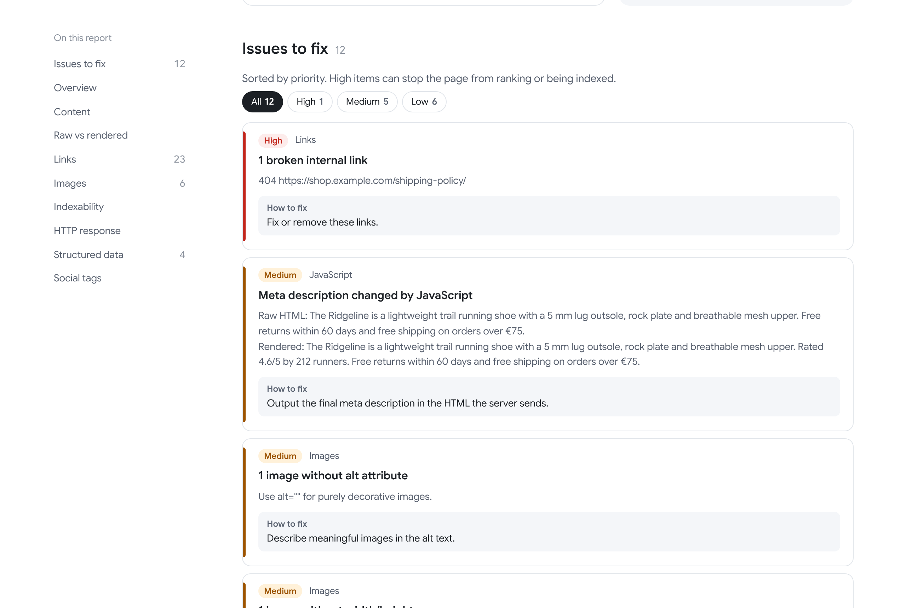

**Spreadsheet (XLSX).** This is one styled sheet per section: Summary, Issues, Headings, Links, Images, Raw vs rendered, JS-only links, Hreflang, HTTP headers, Redirects, Structured data and Social tags. Status cells are colour-coded and URLs are clickable. It is written by a small built-in writer (`xlsx-lite.js`), so there is no SheetJS dependency.

The Links and Images sections each have their own export button that saves just the filtered table.

Files are named `pure-seo-report-<domain>-<date>.html` / `.xlsx`, `pure-seo-links.xlsx` and `pure-seo-images.xlsx`. Sample exports from the demo page used for the screenshots are in [`docs/samples/`](docs/samples/).

## How the checks work

A few details matter when you compare Pure SEO's results with other tools.

**robots.txt** is parsed following RFC 9309 and Google's documented behaviour:
- The most specific user-agent group wins (`googlebot` over `*`), and groups for the same agent are merged.
- The longest matching pattern wins, and Allow wins a tie.
- `*` and `$` are supported.
- Only the first 500 KiB is read.
- A 4xx response means no restrictions, while 429 or 5xx means the whole site is treated as disallowed.
- Common misspellings such as `Dissallow` are accepted, as Google does.

**Raw HTML** is fetched without running JavaScript and parsed with the same rules the live-page extraction uses, so both sides compare like for like. The raw `<head>` used for the canonical check is read as a stream and stops at `</head>`. The full raw HTML for the comparison is capped at 5 MB.

**Link and image checks** are polite to the site:
- At most 8 requests run in flight, at most 2 per host, with 120 ms between starts on one host.
- HEAD is tried first, with GET as a fallback when the server rejects or mishandles HEAD.
- There is one retry after 429/502/503/504, honouring `Retry-After` up to 5 seconds.
- No cookies are sent, so checking a logout link can't log you out.
- Each unique URL is requested once, even if the page links it many times.

**Headers** are captured from the page's own navigation through `webRequest`, without the `extraHeaders` option. That keeps normal browsing fast. The trade-off is that `Set-Cookie` is not shown for the initial load; it is captured whenever the headers are re-checked.

**Image sizes** come from the browser's Resource Timing data where available. Cross-origin images without `Timing-Allow-Origin` report no size until you run the status check.

**The search preview** is an approximation of desktop results: a 20 px title, a 14 px description and a 600 px column. Google can rewrite titles and snippets, so treat it as a guide.

## Permissions

| Permission | Why it is needed |
| --- | --- |
| `activeTab`, `scripting` | Read the current page (meta tags, headings, links, images, structured data) and draw link highlights when you turn them on. |
| `webRequest` | Record the status code, redirect chain and response headers of the page as it loads. Observation only; Pure SEO never blocks or modifies requests. |
| `<all_urls>` (host permission) | Fetch robots.txt, sitemaps and raw HTML from the site you are inspecting, and check link and image status on whatever hosts the page links to. |
| `storage` | Save your settings locally and keep each tab's header data while the browser's background worker sleeps. |
| `downloads` | Save exported reports. Saving runs in the background so the download still completes when Chrome closes the popup for a Save As dialog. |

## Privacy

- Pure SEO has no analytics, no telemetry and no server of its own.
- The only network requests it makes go to the site you are inspecting and to the URLs that page links to or embeds. These requests only happen when you open the relevant section, run a check or export a report.
- Settings are stored in `chrome.storage.local` on your machine. Captured header data is stored in `chrome.storage.session` and removed when the tab closes.
- The Google Rich Results Test and Schema.org validator links only open if you click them.
- Fonts are bundled, so the popup doesn't call Google Fonts.

## Limitations

- Chrome doesn't allow extensions on `chrome://` pages, the Chrome Web Store or the New Tab page, so Pure SEO shows a notice there instead of results.
- Pure SEO analyses one page at a time. It is an inspector, not a site crawler.
- Raw HTML and robots.txt are fetched by the extension, not by Googlebot. Sites that serve different content by user agent or IP, or that block automated requests, may answer differently than they answer Google.
- Headers for pages loaded before the extension was installed, or answered by a service worker or Chrome's preloading, can't be captured from the original load. Pure SEO re-requests the URL instead and says so.
- Link and image status depends on what the target server returns to a request without cookies. Pages behind a login may report a redirect to the login page.

## Project structure

```
pure-seo/
├── extension/               ← load this folder in chrome://extensions
│   ├── manifest.json        Manifest V3 definition
│   ├── background.js        Service worker: header capture, redirect chains, URL checks, raw HTML / robots.txt fetches, downloads
│   ├── popup.html           Popup shell (sidebar + content area)
│   ├── popup.css            Search Console-style UI, light and dark tokens
│   ├── popup.js             Popup controller: tabs, settings, status checks, link highlighting, export flow
│   ├── extract.js           Runs in the page: collects meta tags, headings, links, images, structured data
│   ├── renderers.js         Renders every section of the popup
│   ├── robots.js            robots.txt parser and matcher (RFC 9309 / Google rules)
│   ├── compare.js           Raw vs rendered comparison (loaded on demand)
│   ├── report.js            HTML report, issue rules and workbook layout (loaded on demand)
│   ├── xlsx-lite.js         Minimal styled .xlsx writer (loaded on demand)
│   ├── icons/               Toolbar and store icons (16, 48, 128 px)
│   └── fonts/               Google Sans and Google Sans Code (SIL OFL 1.1)
├── docs/
│   ├── screenshots/         Images used in this README
│   └── samples/             Example HTML report and XLSX export
└── tools/screenshots/       Script that regenerates the screenshots (see below)
```

`compare.js`, `report.js` and `xlsx-lite.js` load only when they are first needed, which keeps the popup quick to open.

## Development

There is no build step and there are no runtime dependencies. Edit the files in `extension/`, then click reload on the Pure SEO card in `chrome://extensions` and reopen the popup.

- **Debugging the popup:** right-click inside the popup and choose **Inspect**.
- **Debugging the service worker:** click the **service worker** link on the extension card.
- **robots.js unit tests:** this file exports its functions under Node (`module.exports`), so you can test the parser directly:
  ```bash
  node -e "const r=require('./extension/robots.js');const p=r.parseRobotsTxt('User-agent: *\nDisallow: /cart/');console.log(r.robotsTest(p,'https://example.com/cart/x','googlebot'))"
  ```

**Regenerating screenshots.** `tools/screenshots/shoot.py` runs the real popup code in headless Chromium against a demo product page (`tools/screenshots/site/`). The `chrome.*` APIs are replaced by `mock.js`, and every request is served locally through Playwright routing, so nothing goes to the network. The demo page has deliberate problems built in: a broken internal link, a redirecting link, a failing external link, a missing alt, a heavy oversized JPEG and a meta description changed by JavaScript. That way every section shows real findings.

```bash
pip install playwright
playwright install chromium
python tools/screenshots/shoot.py      # PNGs are written to tools/screenshots/out/
```

The hero image at the top of this README is a composite of two of those screenshots.

**Packaging for the Chrome Web Store.** Zip the contents of the `extension` folder, with `manifest.json` at the root of the zip:

```bash
cd extension && zip -r ../pure-seo-1.5.1.zip . -x '.*' && cd ..
```

## Contributing

Bug reports and pull requests are welcome. For a bug, include:
- the URL, if it's public
- which section shows the wrong result
- what you expected to see

For a pull request:
- keep it focused on one change
- keep the no-dependency approach, so no frameworks or bundlers
- check the popup in both light and dark mode before submitting

## License

The code is released under the [MIT License](LICENSE).

The bundled Google Sans and Google Sans Code fonts are licensed separately under the SIL Open Font License 1.1. See `extension/fonts/LICENSE-GoogleSans.txt` and `extension/fonts/LICENSE-GoogleSansCode.txt`.

## Disclaimer

Pure SEO is an independent open-source project. It is not affiliated with, endorsed by, or sponsored by Google, Microsoft, or any other search engine or SEO tool vendor. Google, Googlebot, Search Console, and other product names are trademarks of their respective owners and are used only to describe compatibility and behaviour.

Results are based on the page as the extension sees it and on publicly documented crawler behaviour. They are guidance, not a guarantee of how any search engine will crawl, index, or rank a page. The software is provided "as is", without warranty of any kind (see [LICENSE](LICENSE)).

When the extension checks link status, robots.txt, or sitemaps, it sends requests from your browser to the sites involved. Use it responsibly and in line with the terms of the sites you inspect.
